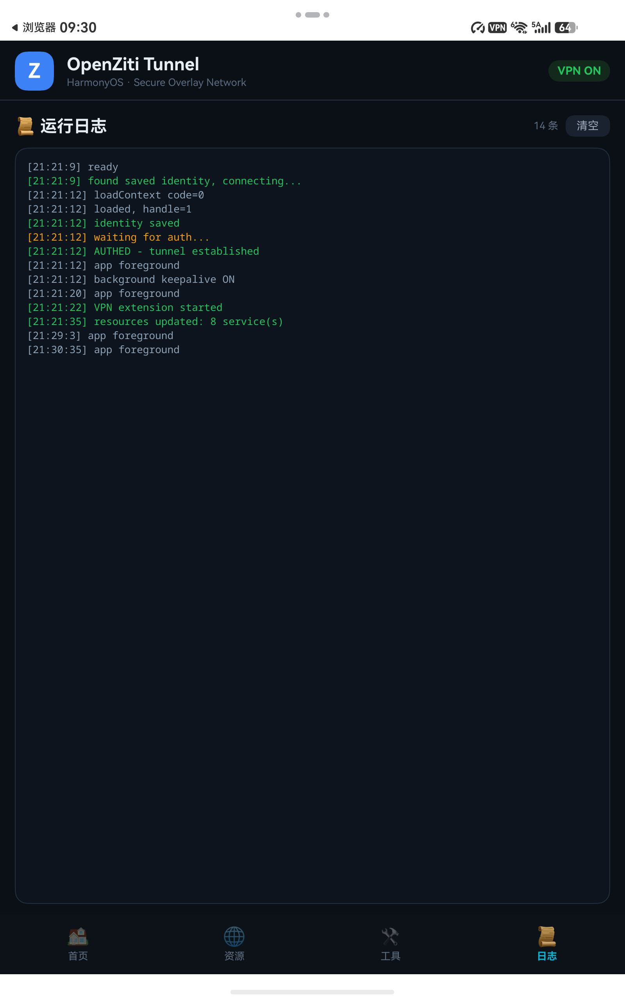
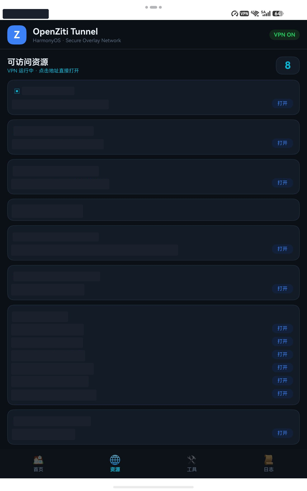
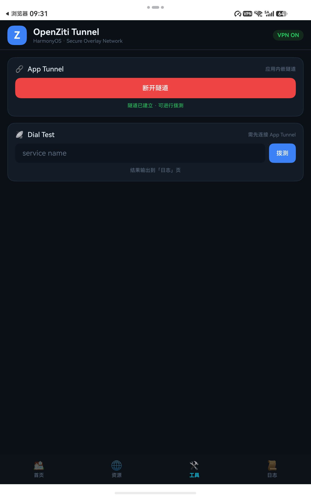

# openziti-client-harmonyos

English | [简体中文](README.zh-CN.md)

A [OpenZiti](https://github.com/openziti/ziti) client for HarmonyOS NEXT.
One single purpose: connect to your OpenZiti zero-trust network. Nothing else.

## What It Does

- Loads a Ziti **identity file** (identity.json) and joins your OpenZiti network
- Runs in **System VPN** (TUN) mode: takes over `100.64.0.0/10`, DNS `100.64.0.2`
- Shows the **list of ziti services** your identity can access (dynamically added/removed)
- With the VPN on, any app on the device — including the browser — can reach ziti services directly (tunneler interception)

> Pure client scope: no server, no gateway, no chat/agent features. Nothing beyond the OpenZiti client itself.

## Screenshots

| Home (VPN + logs) | Services (redacted) | App Tunnel / Dial Test |
|---|---|---|
|  |  |  |

> Internal host names and ports in the services screenshot are redacted.

## Project Layout

```
openziti-client-harmonyos/
└── harmony/                         # DevEco Studio project
    ├── AppScope/
    ├── build-mac.sh                 # one-shot build / sign / install (macOS)
    └── entry/src/main/ets/
        ├── entryability/
        │   ├── EntryAbility.ets           # UIAbility, loads the main page
        │   └── EntryAbilityStage.ets
        ├── model/
        │   └── HubClient.ets              # transport abstraction (reserved)
        ├── pages/
        │   └── Index.ets                  # main UI: VPN switch + service list
        └── vpnextension/
            └── ZitiVpnExtensionAbility.ets  # VpnExtensionAbility + TUN + ziti interception
    └── entry/oh_modules/libziti_ohos.so     # libziti NAPI binding (cross-compiled)
```

## Build & Install

### Command line on macOS (recommended)

Prerequisites: [DevEco Studio](https://developer.huawei.com/consumer/sc/deveco-studio/) installed,
and automatic signing done once inside DevEco (File → Project Structure → Signing Configs →
Automatically generate signature; requires a signed-in, real-name verified developer account).

```bash
cd harmony
./build-mac.sh install    # build + sign + hdc install to tablet + launch
./build-mac.sh            # build & sign only
./build-mac.sh clean install  # clean rebuild
```

Default target device is `192.168.18.32:41285` (hdc over Wi-Fi). Override with:

```bash
PAD_TARGET=192.168.x.x:port ./build-mac.sh install
```

### DevEco Studio

Open the `harmony/` directory, wait for Sync, then Run 'entry' on a connected device.

## Tested On

- HUAWEI MatePad Mini (MLR-AL00), HarmonyOS 7.0.0.111
- Connected via hdc wireless debugging (`hdc tconn <ip>:<port>`)

## Security Notes

- The identity file (identity.json) **is** the credential — leaking it hands over your network access. Keep it safe.
- The auto-generated signing config is for development/debug only; official distribution requires app-store release or enterprise signing.
