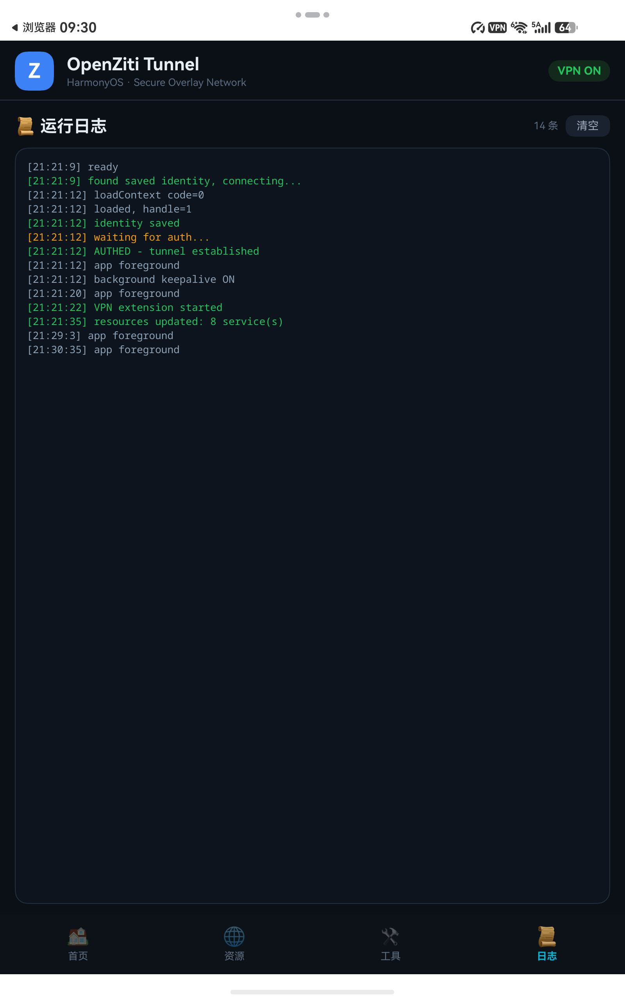
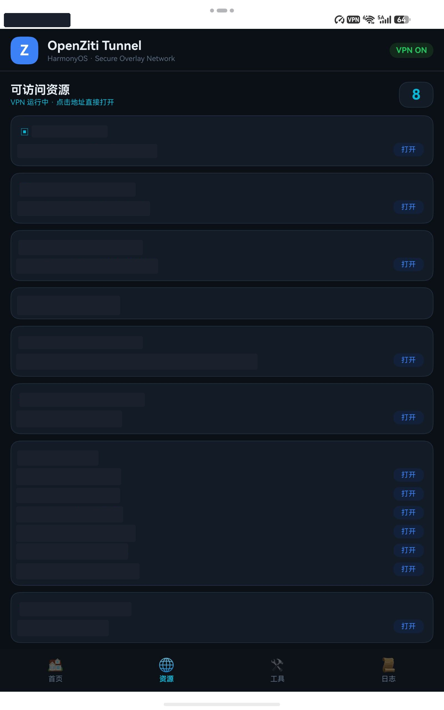
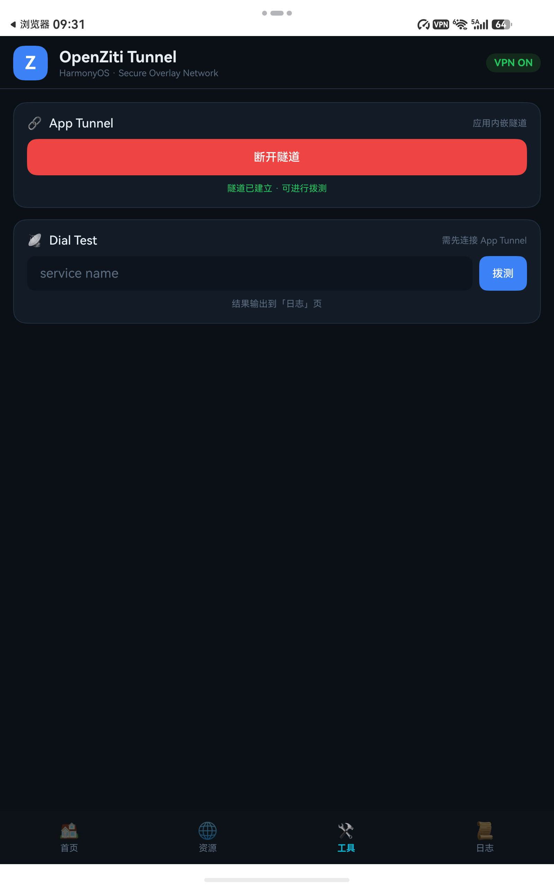

# openziti-client-harmonyos

[English](README.md) | 简体中文

基于 [OpenZiti](https://github.com/openziti/ziti) 开发的鸿蒙（HarmonyOS NEXT）客户端。
仅此一个功能：连接 OpenZiti 零信任网络，没有其他功能。

## 它做什么

- 加载 Ziti **身份文件**（identity.json），接入你的 OpenZiti 网络
- 以 **System VPN**（TUN）模式运行：接管 `100.64.0.0/10`，DNS `100.64.0.2`
- 展示当前身份可访问的 **ziti 服务列表**（动态增删）
- VPN 开启后，系统浏览器等任意 App 即可直接访问 ziti 服务（tunneler 拦截模式）

> 纯客户端定位：不做服务端、不做网关、不做聊天/智能体，任何其他功能都不在本项目范围内。

## 截图

| 首页（VPN + 日志） | 资源列表（已打码） | 应用内嵌隧道 / 拨测 |
|---|---|---|
|  |  |  |

> 资源截图中的内网主机名与端口已涂黑处理。

## 目录结构

```
openziti-client-harmonyos/
└── harmony/                         # DevEco Studio 工程
    ├── AppScope/
    ├── build-mac.sh                 # macOS 一键构建/签名/安装
    └── entry/src/main/ets/
        ├── entryability/
        │   ├── EntryAbility.ets           # UIAbility，加载主页面
        │   └── EntryAbilityStage.ets
        ├── model/
        │   └── HubClient.ets              # 传输层抽象（预留）
        ├── pages/
        │   └── Index.ets                  # 主界面：VPN 开关 + 服务列表
        └── vpnextension/
            └── ZitiVpnExtensionAbility.ets  # VpnExtensionAbility + TUN + ziti 拦截
    └── entry/oh_modules/libziti_ohos.so     # libziti NAPI 绑定（交叉编译产物）
```

## 构建与安装

### macOS 命令行（推荐）

前置：已安装 [DevEco Studio](https://developer.huawei.com/consumer/sc/deveco-studio/)，
并在 DevEco 里完成一次自动签名（File → Project Structure → Signing Configs →
Automatically generate signature，需登录实名开发者账号）。

```bash
cd harmony
./build-mac.sh install    # 编译 + 签名 + hdc 安装到平板 + 启动
./build-mac.sh            # 仅编译签名
./build-mac.sh clean install  # 全量重建
```

默认目标设备 `192.168.18.32:41285`（hdc 无线），可用环境变量覆盖：

```bash
PAD_TARGET=192.168.x.x:port ./build-mac.sh install
```

### DevEco Studio

打开 `harmony/` 目录，Sync 后连接设备 Run 'entry' 即可。

## 实测设备

- 华为 MatePad Mini 悦读版（MLR-AL00），HarmonyOS 7.0.0.111
- 连接方式：hdc 无线调试（`hdc tconn <ip>:<port>`）

## 安全说明

- 身份文件（identity.json）即凭证，泄露等于交出网络访问权，请妥善保管
- 调试签名仅用于开发调试，正式分发需上架或企业签名
